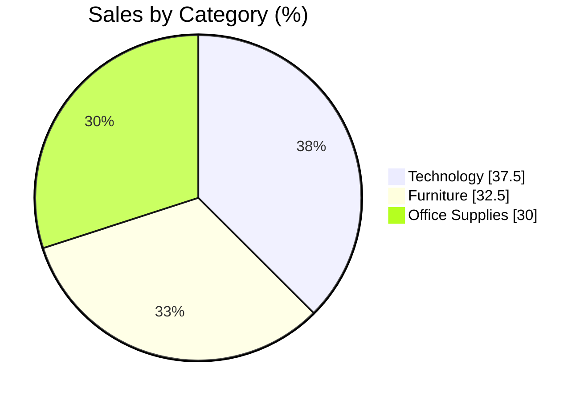

<div align="center">


**From 51,000+ retail orders to clear business decisions.**

</div>

---

## ✨ Overview

An in-depth Power BI analysis of the Superstore dataset: sales, discount, profit and shipping cost, explored across **time**, **customer segments**, **product categories** and **shipping modes**.

📘 Full details are in [`Super_Store_Sales_Analysis_report.pdf`](Super_Store_Sales_Analysis_report.pdf)

---

## 📊 Insights at a Glance

<div align="center">

| 🛍️ Top Category | 🏆 Top Product | 👥 Top Segment | 🚚 Top Shipping | 🎄 Peak Season |
|:---:|:---:|:---:|:---:|:---:|
| **Technology**<br/>37.5% | **Phones**<br/>highest revenue | **Consumer**<br/>sales & profit | **Standard Class**<br/>most profit | **Q4**<br/>Oct – Dec |

</div>



---

## 🎯 Recommendations

| | |
|:--|:--|
| 📱 **Focus on Technology**, especially Phones | 🎯 **Target the Consumer segment** |
| 🚚 **Keep Standard Class** as the main shipping mode | 🎄 **Prepare inventory and marketing for Q4** |

---

## 📁 Files

```
├── 📊 SuperstoreSales_report.pbix            Power BI dashboard
├── 📑 SuperstoreSales_report.pdf             Dashboard export
├── 📘 Super_Store_Sales_Analysis_report.pdf  Full analysis report
└── 🗃️ SuperstoreSales_report_dataset.csv     Dataset
```

**Run it:** download the repo, open `SuperstoreSales_report.pbix` in [Power BI Desktop](https://powerbi.microsoft.com/desktop/), and explore the filters.

---

<div align="center">

⭐ Star this repo if you found it useful


</div>
