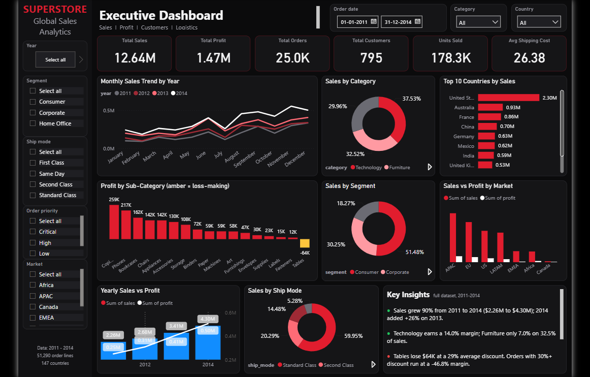

<div align="center">


**Revenue growth is easy to see. Profitable growth is the real story.**

</div>

<br/>

<div align="center">
  
</div>

<br/>

## ⚡ The Numbers

<div align="center">

| 💰 Sales | 📈 Profit | 🧾 Orders | 👥 Customers | 📦 Units | 🚚 Avg Shipping |
|:---:|:---:|:---:|:---:|:---:|:---:|
| **$12.64M** | **$1.47M** | **25.0K** | **795** | **178.3K** | **26.38** |

</div>

---

## 🚀 Growth: Sales Nearly Doubled

```
2011  ███████████░░░░░░░░░  $2.26M   profit $0.25M
2012  ████████████░░░░░░░░  $2.68M   profit $0.31M
2013  ████████████████░░░░  $3.41M   profit $0.41M
2014  ████████████████████  $4.30M   profit $0.50M   ▲ +26% vs 2013
```

**≈ 90% sales growth from 2011 to 2014**, and both sales and profit peaked in 2014.

---

## 🔍 What the Data Says

<table>
<tr>
<td width="50%" valign="top">

### 🟢 What's Working
- **Technology** leads at **37.53%** of sales with a **~14.0%** margin
- **Copiers** ($259K) and **Phones** ($217K) are the top profit drivers
- **Consumer** segment brings **51.48%** of sales
- **United States** leads markets with **$2.30M**
- **Q4** delivers **34%** of annual sales (Nov + Dec alone: **25%**)

</td>
<td width="50%" valign="top">

### 🔴 What's Hurting
- **Tables** lose **$64K** at a **29%** average discount
- Orders with **30%+ discount** run at a **-46.8%** margin
- **Furniture** is 32.52% of sales but only **~7.0%** margin
- **29 of 147 countries** lose money, with **Turkey (-$98K)** and **Nigeria (-$81K)** the worst

</td>
</tr>
</table>

<details>
<summary><b>📊 More breakdowns</b></summary>

<br/>

| Category | Share | | Segment | Share | | Ship Mode | Share |
|:--|:-:|:-:|:--|:-:|:-:|:--|:-:|
| Technology | 37.53% | | Consumer | 51.48% | | Standard Class | 59.95% |
| Furniture | 32.52% | | Corporate | 30.25% | | Second Class | 20.29% |
| Office Supplies | 29.96% | | Home Office | 18.27% | | First Class | 14.48% |
| | | | | | | Same Day | 5.28% |

**Top 5 countries by sales:** 🇺🇸 US $2.30M · 🇦🇺 Australia $0.93M · 🇫🇷 France $0.86M · 🇨🇳 China $0.70M · 🇩🇪 Germany $0.63M

</details>

---

## 🎯 Recommendations

| | |
|:--|:--|
| 📱 **Push Technology**, especially Copiers & Phones | 🏷️ **Cap discounts above 30%** |
| 🪑 **Investigate the Tables loss** at SKU level | 🛋️ **Lift Furniture margin** via mix, pricing & discounts |
| 👥 **Keep Consumer focus**, build offers for Corporate & Home Office | 🚚 **Keep Standard Class** as the core shipping option |
| 🎄 **Prepare inventory and fulfillment for Q4** | 🌍 **Judge markets on profit**, not sales alone |

---

## 📁 Repository

```
├── 📊 Superstore_Executive_Dashboard.pbix      Power BI dashboard
├── 📘 Super_Store_Sales_Analysis_report.pdf    Full analysis report
├── 🖼️ dashboard.png                            Dashboard preview
└── 📄 README.md
```

**Run it:** clone the repo, open `Superstore_Executive_Dashboard.pbix` in [Power BI Desktop](https://powerbi.microsoft.com/desktop/), and use the filters (year, segment, ship mode, order priority, market, category, country).

---

<div align="center">

⭐ **Star this repo if you found it useful** ⭐

<sub>Built by <a href="https://github.com/biswajeet-gitcom">@biswajeet-gitcom</a></sub>


</div>
